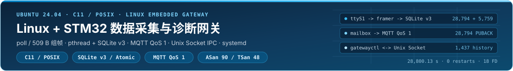
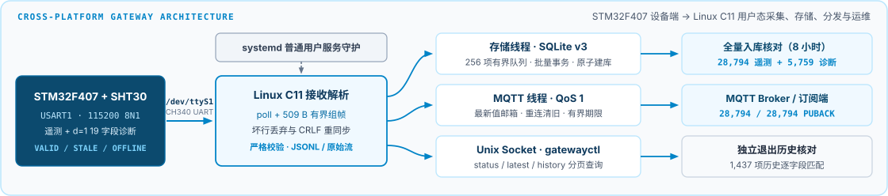

<p align="center">
  
</p>

<p align="center">
  <a href="#快速运行">快速运行</a> ·
  <a href="#核心设计与实板联调">核心设计与联调</a> ·
  <a href="#跨端系统架构">跨端系统架构</a> ·
  <a href="#工程问题与实现">工程问题与实现</a> ·
  <a href="#验收成果与软件复验">验收成果</a> ·
  <a href="#六阶段交付与工程结构">六阶段资料</a> ·
  <a href="https://github.com/tmhcyber/stm32f407-data-terminal">STM32 设备端仓库</a>
</p>

**从 STM32F407 温湿度终端到 Linux C11 历史存储、MQTT 上报与本地诊断查询的完整数据链路。** 以本人开发的 [STM32F407 数据采集与故障诊断终端](https://github.com/tmhcyber/stm32f407-data-terminal) 为设备端输入，构建覆盖串口接收解析、SQLite 并发存储、MQTT QoS 1 分发、Unix Socket 查询、systemd 运维与只读 MCU 诊断的六阶段网关。

---

### 核心实板验收指标

| 连续 8 小时实板运行 | 全量历史入库 | MQTT QoS 1 与资源 | 公开版软件复验 |
| :---: | :---: | :---: | :---: |
| **28,800.13 s · 0 重启** | **28,794 + 5,759** | **28,794 / 28,794** | **90 + 90 + 48 项** |
| 同一普通用户服务身份连续运行，退网退出干净 | 28,794 条遥测（57,588 测点）与 5,759 条诊断全部入库 | 全获 Broker `PUBACK`；RSS `6,080–8,176 KiB`，FD 固定 `18` | 普通与 ASan/UBSan 各 90 项、TSan 专项 48 项全通过 |

<a id="快速运行"></a>

> [!TIP]
> **离线跑通样例：** 克隆仓库后执行 `make`，运行 `build/gateway --replay examples/mixed.bin --boundary aligned` 与 `make test` 即可离线验证 C11 解析、SQLite 建库与完整测试集。
> 完整测试见 [测试指南](docs/TESTING.md) · [阶段 5 服务部署](docs/STAGE5.md) · [实板验收索引](evidence/README.md) · [公开版软件复验](evidence/PUBLIC_RELEASE.md)。

---

<a id="核心设计与实板联调"></a>

## 核心设计与实板联调

围绕设备端输入质量基线、故障现场定义以及跨端实板联调展开，各方向工作边界、工程成果与验证入口如下（详见 [设计决策与个人贡献](docs/CONTRIBUTIONS.md)）：

| 工作方向 | 核心设计与联调内容 | 工程成果与证据 | 入口 |
| :--- | :--- | :--- | :--- |
| **板端质量与串口重同步** | 在设备端完成 SHT30 采集、CRC-8 校验、重试与 `VALID / STALE / OFFLINE` 状态联调；在上位机侧设计串口超长坏行丢弃与 CRLF 重新同步策略 | 构成网关 509 B 有界组帧与严格解析容错基线，持久化 57,588 测点 | [stm32f407-data-terminal](https://github.com/tmhcyber/stm32f407-data-terminal) |
| **MCU 故障与健康门控** | 设计 Fault 现场校验与启动单次消费规则，结合 CFSR、压栈 PC 与反汇编分析 UsageFault；制定 IWDG `ALLOW / HOLD / LATCH` 三态门控与预算 | 定义跨端 `d=1` 诊断帧 19 字段核心语义，长测 5,759 条诊断全入库 | [`docs/STAGE6.md`](docs/STAGE6.md) |
| **跨端架构规划与实板验收** | 规划串口接收、SQLite、MQTT QoS 1、Unix Socket、systemd 与 MCU 诊断六阶段链路；完成 `/dev/ttyS1` 实板接入、复位/`UsageFault/IWDG` 恢复与 8 小时验收 | 连续运行 **28,800.134802 s、0 服务重启**，28,794 条遥测全获 `PUBACK` | [`docs/STAGE6_FINAL.md`](docs/STAGE6_FINAL.md) |

---

<a id="跨端系统架构"></a>

## 跨端系统架构

设备端遥测与诊断通过串口接入 Linux 用户态守护进程后，解析线程将字节流转为带时间戳与质量状态的强类型记录，并由 `pthread` 分离 SQLite 事务入库、MQTT QoS 1 实时分发与 `gatewayctl` 本地查询（详见 [架构与源码导航](docs/ARCHITECTURE.md)）：

<p align="center">
  <picture>
    <source media="(prefers-color-scheme: dark)" srcset="docs/assets/gateway-architecture-dark.svg">
    <source media="(prefers-color-scheme: light)" srcset="docs/assets/gateway-architecture-light.svg">
    
  </picture>
</p>

---

<a id="工程问题与实现"></a>

## 工程问题与实现

| 工程问题 | 实现方案 | 验证结果 |
| :--- | :--- | :--- |
| **串口分段、噪声与数据质量** | 非阻塞 `poll/read`、509 字节有界组帧、严格字段校验、断链退避和静默检测，保留原始字节位置 | 连续 1 小时 3,599 条合法记录，原始流 ASan 回放逐条一致 |
| **磁盘 I/O 与采集并发** | 存储线程独占 SQLite，256 项队列、批量事务、降级重试和恢复计数 | 锁竞争、`FULL/IOERR` 恢复、迁移与保留清理回归通过 |
| **网络故障与本地历史** | MQTT 独立线程、QoS 1、最新值邮箱及连接/ACK 期限；SQLite 保存完整历史 | Broker 停机 600.09 s，期间 601 条遥测全部入库，恢复后发布最新值 |
| **历史查询与接收调度** | `gatewayctl` 提供 `status/latest/history`；分页、请求 ID、慢客户端隔离与查询预算 | 压力和生命周期测试通过，长测 1,437 项历史返回逐字段匹配 |
| **服务部署与版本追溯** | 专用普通用户、固定版本发布、systemd 故障重启、journald、配置分离及回滚 | 连续 8 小时同一服务身份、0 重启，源码与二进制哈希核对通过 |
| **MCU 故障的跨端诊断** | 解析复位、Fault 寄存器、健康状态和看门狗字段，贯通 SQLite、IPC 与 MQTT | 软件复位、`UsageFault/IWDG` 恢复通过，长测 5,759 条诊断全部入库 |

---

<a id="验收成果与软件复验"></a>

## 验收成果与软件复验

| 检查项 | 已取得的结果 | 证据入口 |
| :--- | :--- | :--- |
| **最终实板连续运行** | **28,800.134802 秒，0 服务重启** | [运行结果 JSON](evidence/results/stage6-8h.json) |
| **历史存储** | **28,794 条遥测、57,588 个测点、5,759 条诊断全部入库** | [实板验收报告](evidence/README.md) |
| **MQTT 与历史查询** | **28,794 条遥测获 Broker 确认；1,437 项历史返回逐字段核对通过** | [独立核对 JSON](evidence/results/stage6-8h-postcheck.json) |
| **进程资源观测** | RSS **`6,080–8,176 KiB`**，文件描述符固定 **`18`** | [独立核对 JSON](evidence/results/stage6-8h-postcheck.json) |
| **公开版软件复验** | 普通、ASan/UBSan 各 **90 项**；TSan 专项 **48 项** 通过 | [复验报告](evidence/PUBLIC_RELEASE.md) · [普通](evidence/public-release/normal-suite.json) · [ASan](evidence/public-release/asan-suite.json) · [TSan](evidence/public-release/tsan.json) |
| **实板故障诊断** | 正常、晚连接、软件复位、`UsageFault/IWDG` 恢复及 120 秒服务联调通过 | [实板结果](docs/STAGE6_FINAL.md) |

> 测试环境为 Ubuntu 24.04 x86_64，实板通过 Windows CH340 → VirtualBox UART2 → `/dev/ttyS1` 接入。完整数据、版本与测试方法见 [验收索引](evidence/README.md)。

---

## 快速构建与离线复现

在 Ubuntu 24.04 中安装依赖并编译：

```bash
sudo apt-get update
sudo apt-get install -y build-essential pkg-config python3 git libsqlite3-dev \
  libmosquitto-dev mosquitto mosquitto-clients
git clone https://github.com/tmhcyber/linux-stm32-gateway.git
cd linux-stm32-gateway
make
```

使用仓库自带的 MCU C 格式器样例，离线跑通解析、SQLite 存储与回归测试：

```bash
demo=$(mktemp -d)
build/gateway --replay examples/mixed.bin --boundary aligned \
  --output "$demo/run" --db "$demo/history.sqlite"
python3 -m json.tool "$demo/run/summary.json"
make test
```

---

<a id="六阶段交付与工程结构"></a>

## 六阶段交付与工程结构

```text
linux-stm32-gateway/
├── src/ & include/        # C11 网关核心 (serial/framer/protocol/storage/mqtt/ipc/query/gatewayctl)
├── config/                # systemd 服务单元 (stm32-gateway.service) 与运行时配置模板
├── examples/              # 离线回放样本 (mixed.bin / telemetry.bin)
├── fixtures/mcu-stage6/   # 阶段 6 MCU 诊断格式器固定输入与回归校验
├── scripts/               # Linux 验收/Sanitizer 脚本与 Windows 同步及历史安全检查脚本
├── tests/                 # C 单元/并发/容错测试与 Python 端到端/安全测试
├── docs/                  # 阶段 1–6 设计说明、架构导航、贡献与公开校验说明
└── evidence/              # 8 小时实板验收、ASan/TSan 复验与源码/证据 SHA256 清单
```

| 阶段 | 交付内容 | 文档入口 |
| :--- | :--- | :--- |
| **Stage 1** | Ubuntu 环境、串口映射、可靠采集与源码快照 | [环境与接入](docs/STAGE1.md) |
| **Stage 2** | C11 接收、v1 协议解析、回放与连续 1 小时实板 | [接收与协议](docs/STAGE2.md) |
| **Stage 3** | `pthread`、SQLite 历史、事务恢复与保留清理 | [并发与存储](docs/STAGE3.md) |
| **Stage 4** | MQTT QoS 1、最新值邮箱与断网恢复 | [实时分发](docs/STAGE4.md) |
| **Stage 5** | Unix Socket 查询、CLI、`systemd` 部署与运维 | [本地接口与部署](docs/STAGE5.md) |
| **Stage 6** | MCU 诊断贯通、实板恢复与最终连续 8 小时验收 | [诊断协议](docs/STAGE6.md) · [实板验收](docs/STAGE6_FINAL.md) |

[架构与源码导航](docs/ARCHITECTURE.md) · [测试指南](docs/TESTING.md) · [精选验收证据](evidence/README.md) · [公开材料说明](docs/PUBLICATION.md) · [STM32 设备端仓库](https://github.com/tmhcyber/stm32f407-data-terminal)
