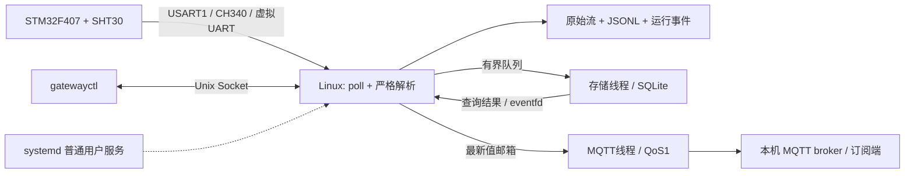

# Linux + STM32 数据采集与诊断网关

**从 STM32 温湿度终端到 Linux 历史存储、MQTT 上报和本地诊断查询的完整数据链路。**

以本人已有的 STM32F407 / SHT30 终端为数据源，将板端采样、数据质量和故障信息接入 Linux 用户态网关。项目覆盖串口接收、协议解析、并发存储、消息分发、服务部署和实板验收，阶段1—6于 **2026-11-14全部结项**。

`C11` · `Linux/POSIX` · `pthread` · `SQLite` · `MQTT QoS1` · `Unix Socket` · `systemd` · `STM32F407`

## 系统架构



## 核心能力

| 能力 | 实现与工程价值 |
| --- | --- |
| 串口与协议 | 非阻塞 `poll/read`、509字节有界组帧、严格字段校验、断链退避和静默检测；记录原始字节位置，便于定位异常 |
| 并发与持久化 | 接收、存储、MQTT分工；SQLite由单线程独占，256项队列与批量事务控制积压，故障恢复后继续提交 |
| MQTT分发 | QoS1、在线状态与遗嘱、连接/ACK期限、重连；最新值邮箱保障实时分发，完整历史独立保存在SQLite |
| 本地查询 | C客户端 `gatewayctl` 提供 `status/latest/history`；分页查询、慢客户端隔离和查询预算保护采集主循环 |
| 服务运维 | 专用普通用户、固定版本发布、systemd启停与故障重启、journald、配置分离及回滚 |
| MCU诊断 | 独立解析复位原因、Fault寄存器、健康状态和看门狗字段，贯通SQLite、IPC及MQTT状态展示 |

## 我的贡献

- **板端项目基础：**提供已有 STM32F407 / SHT30 温湿度终端及其 UART 数据链路，作为网关接入与实板验证对象。
- **需求与交付决策：**确定六阶段推进目标、实板联调要求和连续8小时验收标准，推动从采集到历史、上报和诊断的完整交付。
- **实板配合：**参与供电、连接及串口恢复等现场配合，为软硬件联调提供实际运行条件。

开发协作分工见[贡献说明](docs/CONTRIBUTIONS.md)。

## 验收成果

| 检查 | 已取得的结果 | 证据 |
| --- | --- | --- |
| 最终实板连续运行 | **28,800.134802秒，0服务重启** | [运行结果](evidence/results/stage6-8h.json) |
| 历史存储 | **28,794条遥测、57,588个测点、5,759条诊断全部入库** | [验收报告](evidence/README.md) |
| MQTT与查询 | **28,794条遥测获broker确认；1,437项历史返回逐字段核对通过** | [独立核对](evidence/results/stage6-8h-postcheck.json) |
| 资源观测 | RSS **6,080—8,176 KiB**，文件描述符固定18 | [独立核对](evidence/results/stage6-8h-postcheck.json) |
| 最终软件基线 | 普通、ASan/UBSan各 **83项**；TSan专项 **48项**通过 | [普通](evidence/results/stage6-normal-suite.json) / [ASan](evidence/results/stage6-asan-suite.json) / [TSan](evidence/results/stage6-tsan.json) |
| 实板故障诊断 | 正常、晚连接、软件复位、UsageFault/IWDG恢复及120秒服务联调通过 | [实板结果](docs/STAGE6_FINAL.md) |

测试环境为 Ubuntu 24.04 x86_64，实板通过 Windows CH340 → VirtualBox UART2 → `/dev/ttyS1` 接入。完整数据、版本和测试方法见[验收索引](evidence/README.md)。

## 快速运行

在 Ubuntu 24.04 中安装依赖并编译：

```bash
sudo apt-get update
sudo apt-get install -y build-essential pkg-config python3 git libsqlite3-dev \
  libmosquitto-dev mosquitto mosquitto-clients
git clone https://github.com/tmhcyber/linux-stm32-gateway.git
cd linux-stm32-gateway
make
```

使用仓库自带的 MCU C 格式器样例，离线跑通解析与存储：

```bash
demo=$(mktemp -d)
build/gateway --replay examples/mixed.bin --boundary aligned \
  --output "$demo/run" --db "$demo/history.sqlite"
python3 -m json.tool "$demo/run/summary.json"
make test
```

连接开发板与查询运行状态见[阶段5](docs/STAGE5.md)；完整测试和诊断参考复现见[测试指南](docs/TESTING.md)。

## 六阶段交付与技术资料

| 阶段 | 交付内容 | 文档 |
| --- | --- | --- |
| 1 | Ubuntu环境、串口映射、可靠采集与源码快照 | [环境与接入](docs/STAGE1.md) |
| 2 | C11接收、v1协议解析、回放、连续1小时实板 | [接收与协议](docs/STAGE2.md) |
| 3 | pthread、SQLite历史、事务恢复与保留清理 | [并发与存储](docs/STAGE3.md) |
| 4 | MQTT QoS1、最新值邮箱、断网恢复 | [实时分发](docs/STAGE4.md) |
| 5 | Unix Socket查询、CLI、systemd部署与运维 | [本地接口与部署](docs/STAGE5.md) |
| 6 | MCU诊断贯通、实板恢复、最终连续8小时验收 | [诊断协议](docs/STAGE6.md) / [实板验收](docs/STAGE6_FINAL.md) |

[架构与源码导航](docs/ARCHITECTURE.md) · [测试指南](docs/TESTING.md) · [精选验收证据](evidence/README.md) · [公开材料说明](docs/PUBLICATION.md)
