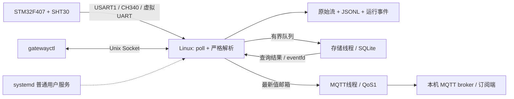

# Linux + STM32 数据采集与诊断网关

陶铭浩 · 2027届 · 嵌入式软件 / MCU固件方向

**从 STM32 温湿度终端到 Linux 历史存储、MQTT 上报和本地诊断查询的完整数据链路。**

基于本人开发的 STM32F407 / SHT30 数据采集与故障诊断终端，构建从板端 UART 遥测与诊断上报到 Linux C11 接收、SQLite 历史存储、MQTT QoS 1 分发、Unix Socket 查询及 systemd 服务的六阶段完整数据链路。

`C11` · `Linux/POSIX` · `pthread` · `SQLite` · `MQTT QoS1` · `Unix Socket` · `systemd` · `STM32F407`

**交付结果：连续8小时实板运行、0服务重启，28,794条遥测与5,759条诊断全部入库；公开版普通与ASan/UBSan各90项、TSan专项48项通过。** [实板验收](evidence/README.md) · [公开版软件复验](evidence/PUBLIC_RELEASE.md)

## 我的主要工作

- **板端数据质量与串口重同步设计：** 在 [STM32F407 数据采集终端](https://github.com/tmhcyber/stm32f407-data-terminal) 中完成 SHT30 采集、CRC-8 校验、重试与 `VALID / STALE / OFFLINE` 质量状态联调，设计串口超长坏行丢弃与 CRLF 重新同步策略，作为网关协议解析的设备端输入与容错基线。
- **MCU 故障记录与健康门控设计：** 设计 Fault 现场记录校验与启动消费规则，结合 CFSR、压栈 PC 与反汇编定位 UsageFault；制定 IWDG `ALLOW / HOLD / LATCH` 三态健康门控条件与时间预算，定义跨端 `d=1` 诊断帧的核心状态语义。
- **跨端数据链路规划与实板联调验收：** 规划串口接收、SQLite 历史存储、MQTT QoS 1 分发、Unix Socket 查询、systemd 部署与 MCU 诊断贯通的六阶段架构；完成 STM32 至 Ubuntu `/dev/ttyS1` 实板接入、软件复位与 `UsageFault/IWDG` 恢复联调，以及连续 8 小时（**28,794 条遥测、5,759 条诊断全部入库，0 服务重启**）实板验收。

[设计决策与个人贡献](docs/CONTRIBUTIONS.md)提供跨端设计细节与验证依据。

## 系统架构



## 工程问题与实现

| 工程问题 | 实现方案 | 验证结果 |
| --- | --- | --- |
| 串口分段、噪声与数据质量 | 非阻塞 `poll/read`、509字节有界组帧、严格字段校验、断链退避和静默检测，保留原始字节位置 | 连续1小时3,599条合法记录，原始流ASan回放逐条一致 |
| 磁盘I/O与采集并发 | 存储线程独占SQLite，256项队列、批量事务、降级重试和恢复计数 | 锁竞争、FULL/IOERR恢复、迁移与保留清理回归通过 |
| 网络故障与本地历史 | MQTT独立线程、QoS1、最新值邮箱及连接/ACK期限；SQLite保存完整历史 | broker停机约600秒，期间601条遥测全部入库，恢复后发布最新值 |
| 历史查询与接收调度 | `gatewayctl`提供 `status/latest/history`；分页、请求ID、慢客户端隔离与查询预算 | 压力和生命周期测试通过，长测1,437项历史返回逐字段匹配 |
| 服务部署与版本追溯 | 专用普通用户、固定版本发布、systemd故障重启、journald、配置分离及回滚 | 连续8小时同一服务身份、0重启，源码与二进制哈希核对通过 |
| MCU故障的跨端诊断 | 解析复位、Fault寄存器、健康状态和看门狗字段，贯通SQLite、IPC与MQTT | 软件复位、UsageFault/IWDG恢复通过，长测5,759条诊断全部入库 |

## 验收成果

| 检查 | 已取得的结果 | 证据 |
| --- | --- | --- |
| 最终实板连续运行 | **28,800.134802秒，0服务重启** | [运行结果](evidence/results/stage6-8h.json) |
| 历史存储 | **28,794条遥测、57,588个测点、5,759条诊断全部入库** | [验收报告](evidence/README.md) |
| MQTT与查询 | **28,794条遥测获broker确认；1,437项历史返回逐字段核对通过** | [独立核对](evidence/results/stage6-8h-postcheck.json) |
| 资源观测 | RSS **6,080—8,176 KiB**，文件描述符固定18 | [独立核对](evidence/results/stage6-8h-postcheck.json) |
| 公开版软件复验 | 普通、ASan/UBSan各 **90项**；TSan专项 **48项**通过 | [复验报告](evidence/PUBLIC_RELEASE.md) / [普通](evidence/public-release/normal-suite.json) / [ASan](evidence/public-release/asan-suite.json) / [TSan](evidence/public-release/tsan.json) |
| 实板故障诊断 | 正常、晚连接、软件复位、UsageFault/IWDG恢复及120秒服务联调通过 | [实板结果](docs/STAGE6_FINAL.md) |

测试环境为 Ubuntu 24.04 x86_64，实板通过 Windows CH340 → VirtualBox UART2 → `/dev/ttyS1` 接入。完整数据、版本和测试方法见[验收索引](evidence/README.md)。

## 快速运行

在 Ubuntu 24.04 中安装依赖并编译：

```bash
sudo apt-get update
sudo apt-get install -y build-essential pkg-config python3 git libsqlite3-dev \
  libmosquitto-dev mosquitto mosquitto-clients
git clone https://github.com/tmhcyber/linux-stm32-gateway.git
cd linux-stm32-gateway
make
```

使用仓库自带的 MCU C 格式器样例，离线跑通解析与存储：

```bash
demo=$(mktemp -d)
build/gateway --replay examples/mixed.bin --boundary aligned \
  --output "$demo/run" --db "$demo/history.sqlite"
python3 -m json.tool "$demo/run/summary.json"
make test
```

连接开发板与查询运行状态见[阶段5](docs/STAGE5.md)；完整测试和诊断参考复现见[测试指南](docs/TESTING.md)。

## 六阶段交付与技术资料

| 阶段 | 交付内容 | 文档 |
| --- | --- | --- |
| 1 | Ubuntu环境、串口映射、可靠采集与源码快照 | [环境与接入](docs/STAGE1.md) |
| 2 | C11接收、v1协议解析、回放、连续1小时实板 | [接收与协议](docs/STAGE2.md) |
| 3 | pthread、SQLite历史、事务恢复与保留清理 | [并发与存储](docs/STAGE3.md) |
| 4 | MQTT QoS1、最新值邮箱、断网恢复 | [实时分发](docs/STAGE4.md) |
| 5 | Unix Socket查询、CLI、systemd部署与运维 | [本地接口与部署](docs/STAGE5.md) |
| 6 | MCU诊断贯通、实板恢复、最终连续8小时验收 | [诊断协议](docs/STAGE6.md) / [实板验收](docs/STAGE6_FINAL.md) |

[架构与源码导航](docs/ARCHITECTURE.md) · [测试指南](docs/TESTING.md) · [精选验收证据](evidence/README.md) · [公开材料说明](docs/PUBLICATION.md)
